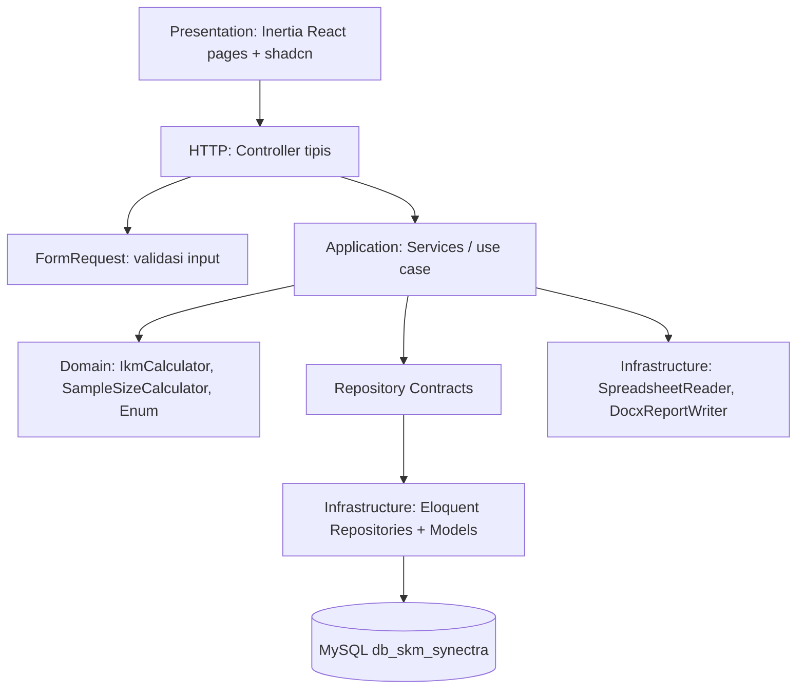
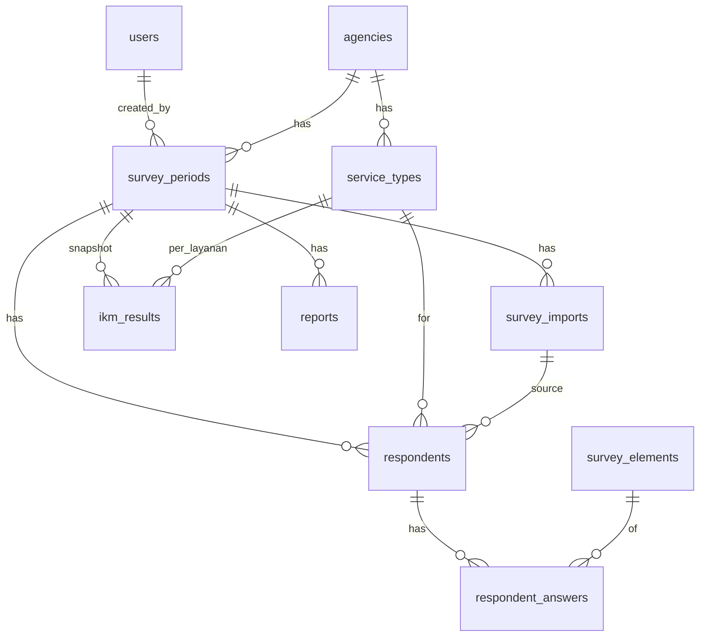

# Arsitektur SKM Synectra (Laravel Multilayer)

Aplikasi pembuat laporan Survei Kepuasan Masyarakat (Permenpan-RB 14/2017) versi server.
Menggantikan versi statis `../dist-shared-hosting` untuk instansi yang butuh penyimpanan data per periode.

## 1. Tech Stack (terverifikasi terpasang)

| Lapisan | Teknologi | Versi |
|---|---|---|
| Backend | Laravel (react-starter-kit) | 12.74 |
| PHP | Laragon | 8.3.30 |
| Database | MySQL (kelola via phpMyAdmin Laragon) | 8.4.3 |
| Frontend | Inertia.js v2 + React 19 + TypeScript | — |
| UI | shadcn/ui (Radix) + Tailwind CSS v4 + lucide-react | — |
| Excel/CSV | phpoffice/phpspreadsheet | ^5.12 |
| Word | phpoffice/phpword | ^1.4 |

Belum terpasang, boleh ditambah UI agent bila perlu: komponen shadcn `table`, `tabs`, `progress`, `textarea`, `sonner`, `chart` (Recharts). Tambah dengan `npx shadcn@latest add <nama>`.

## 2. Lapisan (alur satu arah, lapisan atas hanya memanggil lapisan bawah)



Aturan:
1. **Controller** hanya: terima `FormRequest`, panggil 1 service, kembalikan `Inertia::render` / redirect / download. Tidak ada query atau rumus.
2. **Service** memegang transaksi DB (`DB::transaction`) dan alur bisnis. Tidak memanggil `Request` atau `Inertia`.
3. **Domain** (`app/Domain`) PHP murni, tanpa Eloquent/facade. Sudah ditulis dan diuji: `IkmCalculator`, `SampleSizeCalculator`, `IkmResultData`, `ElementScoreData`.
4. **Repository**: interface di `app/Repositories/Contracts`, implementasi Eloquent di `app/Repositories/Eloquent`, di-bind di `App\Providers\RepositoryServiceProvider` (daftarkan di `bootstrap/providers.php`).
5. Data ke UI lewat array dari DTO `toArray()` / API Resource, jangan kirim model mentah.

## 3. Struktur Folder

```
app/
  Domain/Ikm/                IkmCalculator, SampleSizeCalculator, IkmResultData, ElementScoreData   [SELESAI]
  Enums/                     PeriodStatus, ServiceGrade                                          [SELESAI]
  Models/                    Agency, SurveyElement, ServiceType, SurveyPeriod, SurveyImport,
                             Respondent, RespondentAnswer, IkmResult, Report, User(role)        [SELESAI]
  Repositories/Contracts/    AgencyRepositoryInterface, SurveyPeriodRepositoryInterface,
                             RespondentRepositoryInterface, IkmResultRepositoryInterface
  Repositories/Eloquent/     implementasi tiap interface
  Services/                  AgencyService, SurveyPeriodService, SurveyImportService,
                             IkmCalculationService, ReportService
  Support/Import/            SpreadsheetReader (csv/xlsx/xls), ColumnMatcher (alias 9 unsur)
  Support/Report/            DocxReportWriter (BAB I-IV), MarkdownReportWriter
  Http/Controllers/          DashboardController, AgencyController, SurveyPeriodController,
                             SurveyImportController, IkmResultController, ReportController,
                             QuickCalculatorController
  Http/Requests/             StoreAgencyRequest, StoreSurveyPeriodRequest, UploadSurveyFileRequest,
                             ConfirmImportMappingRequest, QuickCalculateRequest
  Providers/RepositoryServiceProvider.php
resources/js/
  pages/                     welcome, dashboard, agencies/*, periods/*, imports/*, results/show,
                             calculator, guide
  components/skm/            komponen domain (GradeBadge, IkmScoreCard, ElementBarChart, ...)
public/images/skm/           aset gambar (logo, hero, ilustrasi, empty state)
database/sql/                db_skm_synectra.sql (dump untuk import phpMyAdmin di shared hosting)
tests/Unit, tests/Feature
```

## 4. Skema Database (`db_skm_synectra`, utf8mb4)



| Tabel | Isi penting |
|---|---|
| `users` | + `role` enum(admin, operator) |
| `agencies` | nama instansi, unit, alamat, kota, kepala (nama, NIP, jabatan), logo |
| `survey_elements` | master U1–U9, nama, pertanyaan, `aliases` JSON (untuk ColumnMatcher) |
| `service_types` | jenis layanan per instansi, unik (agency_id, name) |
| `survey_periods` | label, tanggal mulai/selesai, `population` (Krejcie-Morgan), status draft/active/closed |
| `survey_imports` | file asal, `column_mapping` JSON, jumlah baris total/valid/invalid, `error_log` JSON |
| `respondents` | **anonim**: gender, usia, pendidikan, pekerjaan, tanggal, saran. Tidak ada nama/NIK/HP |
| `respondent_answers` | skor 1–4, unik (respondent_id, survey_element_id) |
| `ikm_results` | snapshot hasil; `service_type_id` NULL = keseluruhan unit; `element_scores` JSON |
| `reports` | riwayat file laporan (docx/md) di `storage/app/reports` |

Migrasi: `database/migrations/2026_11_25_000100_create_skm_core_tables.php`. Seeder: 9 unsur, admin `admin@skm.test` / `password`, 1 instansi contoh, 1 periode, 50 responden contoh.

## 5. Kontrak Route & Props Inertia (pegangan bersama backend ↔ UI)

Semua di bawah middleware `auth` kecuali `/`, `/kalkulator`, `/panduan`.

| Method | URL | Name | Page / Respon | Props utama |
|---|---|---|---|---|
| GET | `/` | home | `welcome` | — |
| GET | `/kalkulator` | calculator | `calculator` | `elements: Element[]` |
| POST | `/kalkulator` | calculator.calculate | `calculator` | + `result: IkmResult` |
| GET | `/panduan` | guide | `guide` | `elements, gradeIntervals` |
| GET | `/dashboard` | dashboard | `dashboard` | `stats{agencies,periods,respondents,latestScore}`, `latestResult: IkmResult\|null`, `recentPeriods: Period[]` |
| resource | `/instansi` | agencies.* | `agencies/index`, `agencies/form` | `agencies: Paginated<Agency>`, `agency?` |
| resource | `/periode` | periods.* | `periods/index`, `periods/form`, `periods/show` | `periods`, `period`, `agencies` |
| GET | `/periode/{period}/impor` | imports.create | `imports/create` | `period` |
| POST | `/periode/{period}/impor` | imports.preview | `imports/mapping` | `importId, headers[], previewRows[][], suggestedMapping{serviceType,U1..U9}`, `elements` |
| POST | `/impor/{import}/konfirmasi` | imports.confirm | redirect → results.show | flash `success` |
| GET | `/periode/{period}/hasil` | results.show | `results/show` | `period, overall: IkmResult, services: ServiceResult[], sample{population,minimum,actual,sufficient}` |
| POST | `/periode/{period}/hitung-ulang` | results.recalculate | redirect | — |
| POST | `/periode/{period}/laporan/{format}` | reports.generate | file download (`docx`\|`md`) | — |

Tipe (taruh di `resources/js/types/skm.d.ts`):

```ts
type Grade = 'A' | 'B' | 'C' | 'D';
interface Element { id: number; code: string; name: string; question: string }
interface ElementScore { code: string; name: string; total: number; nrr: number; nrr_weighted: number; conversion: number; rank: number }
interface IkmResult { respondent_count: number; ikm_weighted: number; ikm_score: number; grade: Grade; performance: string; elements: ElementScore[] }
interface ServiceResult extends IkmResult { service_type_id: number; service_name: string }
interface Agency { id: number; name: string; unit_name?: string; city?: string; head_name?: string; head_nip?: string; head_position?: string }
interface Period { id: number; agency_id: number; agency?: Agency; label: string; start_date: string; end_date: string; population?: number; status: 'draft'|'active'|'closed'; respondents_count?: number }
```

Flash message: `success`, `error` (share di `HandleInertiaRequests`).

## 6. Aturan Bisnis & Kasus Tepi

- Interval mutu: A ≥ 88,31; B 76,61–88,30; C 65,00–76,60; D 25,00–64,99 (`ServiceGrade::fromScore`).
- Baris impor dengan skor kosong / di luar 1–4 / jenis layanan kosong → dilewati, dicatat di `error_log` (nomor baris + alasan), tidak ikut pembagi.
- Jenis layanan baru di file → dibuat otomatis (`firstOrCreate`) untuk instansi periode itu.
- File: csv/xlsx/xls, maks 10 MB, deteksi delimiter `,` `;` tab. Impor ribuan baris pakai `insert` batch per 500 dalam 1 transaksi.
- Hitung ulang menghapus `ikm_results` periode lalu menyimpan 1 baris keseluruhan + 1 per layanan.
- Periode `closed` tidak menerima impor baru.
- Hapus responden mengikuti `cascade`; jenis layanan yang sudah dipakai responden tidak bisa dihapus (`restrictOnDelete`).

## 7. Keputusan & Risiko

| Keputusan | Alasan | Risiko |
|---|---|---|
| Data responden **disimpan di server** (berubah dari PRD "client-side, zero retention") | Diminta: Laravel + database | Wajib anonim; jangan tambah kolom identitas. Perbarui catatan privasi di PRD |
| Inertia + React, bukan Blade | shadcn/ui adalah pustaka React | Shared hosting tidak punya Node: jalankan `npm run build` lokal, unggah folder `public/build` |
| PhpWord untuk .docx, grafik sebagai gambar PNG dari frontend opsional | PhpWord tidak membuat grafik native yang andal | Tahap awal: tabel saja di docx, grafik di layar |
| Shared hosting: document root → `public/` | Standar Laravel | Bila tidak bisa ubah root, pakai `.htaccess` redirect ke `public/` |

## 8. Pembagian Kerja

| Bagian | Pemilik | Status |
|---|---|---|
| Arsitektur, skema DB, migrasi, model, domain, seeder | Software Architect | Selesai |
| Repository, Service, Support (Import/Report), Controller, Request, Route, tes PHPUnit, dump SQL | Core Coder | — |
| Halaman React + shadcn, komponen `skm/`, aset gambar `public/images/skm` | UI & Visual Engineer | — |
| Uji end-to-end di `http://127.0.0.1:8000` | QA Tester | — |

## 9. Menjalankan Lokal

```bash
cd laravel-app
php artisan migrate:fresh --seed   # DB: db_skm_synectra di MySQL Laragon (root, tanpa password)
composer run dev                   # atau: php artisan serve + npm run dev
```
phpMyAdmin Laragon: menu Laragon → Database, atau `http://localhost/phpmyadmin`.
